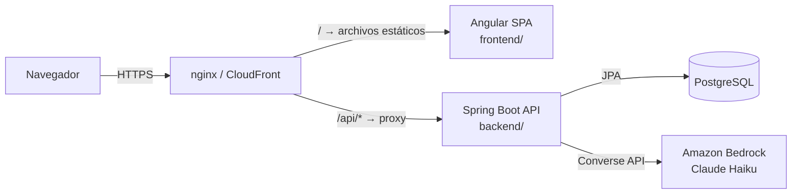
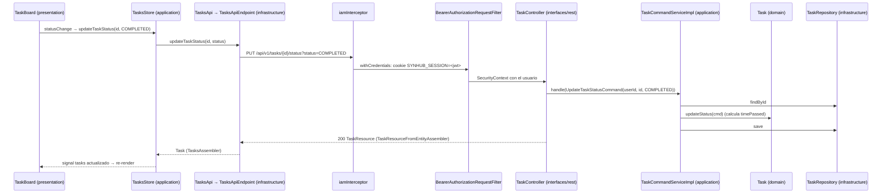

# Arquitectura: visión general

SynHub es una aplicación de gestión ágil de tareas para equipos: grupos con un líder, tareas asignadas, entregas que el líder valida y asistencia de IA. El monorepo contiene dos aplicaciones que se comunican **solo por HTTP/JSON (REST)**.

| Documento | Contenido |
|---|---|
| [backend.md](backend.md) | Spring Boot: DDD (bounded contexts), capas tipo Clean Architecture, CQRS, ACL, seguridad, persistencia y errores. |
| [frontend.md](frontend.md) | Angular: módulos por feature, capas `domain/application/infrastructure/presentation`, stores con signals y patrón endpoint + assembler. |
| [rest-api.md](rest-api.md) | Convenciones de la API y **catálogo completo de endpoints** con su consumidor en el frontend. |
| [cross-feature-ownership.md](cross-feature-ownership.md) | Cómo decidir a qué feature pertenece el código que mezcla varias, y el mapa de dependencias real. |
| [deployment.md](deployment.md) | Docker, docker-compose, variables de entorno y CI/CD en GitHub Actions hacia AWS. |

## Sistema

- **Mismo origen**: en producción el frontend llama a `/api/v1` con una ruta relativa, y el proxy (nginx en Docker, CloudFront en AWS) reenvía las peticiones al backend. No hace falta CORS.
- **Autenticación stateless**: JWT emitido por IAM y validado en cada petición. La web lo recibe en una cookie `HttpOnly` de 1 día (`SYNHUB_SESSION`) que el JavaScript no puede leer; los clientes de API pueden enviarlo como `Authorization: Bearer`.

## Stack

| Capa | Tecnología |
|---|---|
| Frontend | Angular 22 (componentes standalone, signals), RxJS 7.8, Angular Material, Tailwind CSS 4, Vitest |
| Backend | Java 21, Spring Boot 4.1 (Web MVC, Data JPA, Security, Validation, Actuator), JJWT 0.12, springdoc-openapi 3.1, AWS SDK v2 (Bedrock Runtime), Lombok |
| Base de datos | PostgreSQL (16 en Docker y CI); el esquema lo crean las migraciones de Flyway (`db/migration`) y Hibernate solo lo valida |
| Infraestructura | Docker (imagen única nginx + JRE), GitHub Actions, AWS (S3 + CloudFront para el frontend; ECR + ECS para el backend) |

## Principios de organización

1. **El código se organiza por feature (bounded context), no por tipo técnico.** Backend y frontend usan los mismos nombres: `iam`, `groups`, `tasks`, `requests`, `ai`, más `shared`. Encontrar el código de una feature es buscar su carpeta en ambos lados.
2. **DDD táctico en el backend**: agregados, entidades, value objects, comandos, consultas y excepciones de dominio por contexto.
3. **Capas al estilo Clean / Hexagonal** dentro de cada contexto, tanto en el backend (`interfaces → application → domain ← infrastructure`) como en el frontend (`presentation → application → infrastructure → domain`).
4. **CQRS a nivel de servicio**: cada contexto separa `CommandService` (escritura) de `QueryService` (lectura), y cada operación es un `record` *Command* o *Query* con su propio `handle(...)`.
5. **REST orientado a recursos**: una URL raíz por recurso (`/api/v1/groups`, `/api/v1/tasks`…), sub-recursos para las relaciones (`/tasks/{id}/requests`) y DTOs `*Resource` separados del dominio.
6. **Integración entre contextos mediante ACL** (`*ContextFacade`). Es el patrón previsto, aunque todavía hay accesos directos a repositorios de otros contextos; ver [cross-feature-ownership.md](cross-feature-ownership.md).

## Recorrido de una petición

Ejemplo: un integrante mueve su tarea a "Completada" en el tablero.

