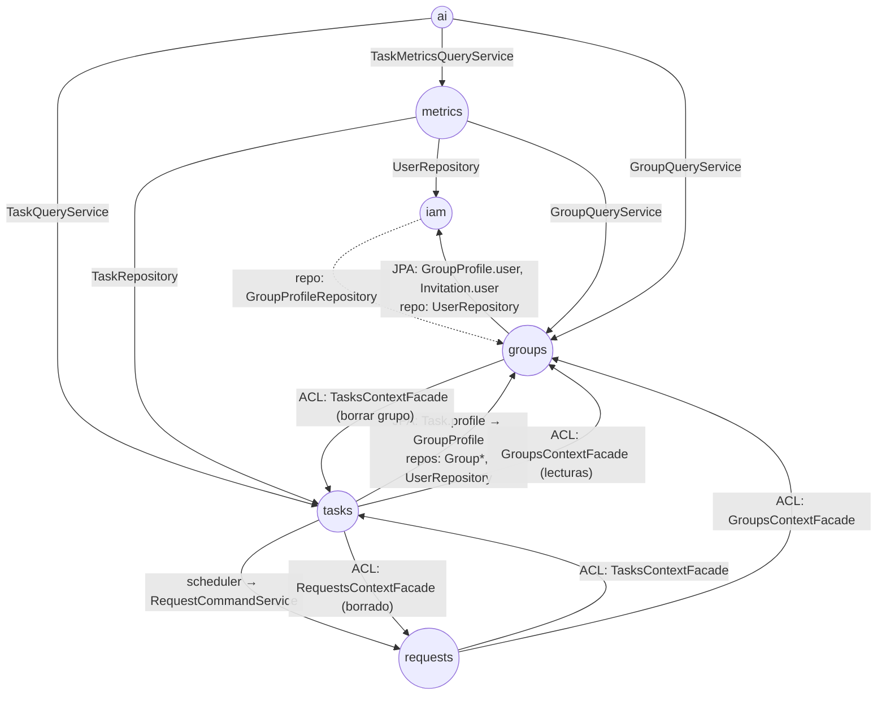

# Arquitectura del backend

Spring Boot 4.1 sobre Java 21. Código en [`backend/src/main/java/com/hub/synhub_backend`](../../backend/src/main/java/com/hub/synhub_backend).

## 1. Bounded contexts (DDD estratégico)

Cada paquete de primer nivel es un **bounded context** con su propio modelo y sus propias capas:

| Contexto | Responsabilidad | Agregados | Feature(s) que documenta |
|---|---|---|---|
| `iam` | Identidad, credenciales, JWT, roles de cuenta | `User` (+ entidad `Role`) | [iam](../features/iam/README.md) |
| `groups` | Grupos, membresías y liderazgo; invitaciones | `Group` (+ entidad `GroupProfile`), `Invitation` | [groups](../features/groups/README.md), [invitations](../features/invitations/README.md) |
| `tasks` | Tareas, su ciclo de estados y su vencimiento automático | `Task` | [tasks](../features/tasks/README.md) |
| `requests` | Solicitudes sobre tareas (entregas, modificaciones, vencimientos) y su revisión | `Request` | [requests](../features/requests/README.md) |
| `ai` | Clasificación de tareas e informes con Amazon Bedrock (sin persistencia) | — (value object `TaskClassification`) | [ai](../features/ai/README.md) |
| `metrics` | Cálculos de productividad sobre tareas (sin persistencia propia) | — (resources de solo lectura) | [metrics](../features/metrics/README.md) |
| `shared` | Clases base, manejo global de errores, OpenAPI y estrategia de nombres JPA | `AuditableAbstractAggregateRoot`, `AuditableModel` | — |

### Mapa de contextos



Las flechas con "ACL" usan una fachada formal; las demás son dependencias directas. Ver [cross-feature-ownership.md](cross-feature-ownership.md).

## 2. Capas dentro de un contexto (Clean Architecture / hexagonal)

Estructura canónica, tomando `groups` como ejemplo:

```text
groups/
├── interfaces/                     ← adaptadores de entrada
│   ├── rest/
│   │   ├── GroupController.java            @RestController
│   │   ├── resources/                       DTOs de la API (records *Resource)
│   │   └── transform/                       assemblers Resource ↔ Command/Entity
│   └── acl/
│       └── GroupsContextFacade.java         contrato que este contexto ofrece a otros
├── application/                    ← casos de uso
│   ├── internal/
│   │   ├── commandservices/                 *CommandServiceImpl (escritura, @Transactional)
│   │   ├── queryservices/                   *QueryServiceImpl (lectura)
│   │   ├── acl/                             implementación de la fachada (*ContextFacadeImpl)
│   │   ├── eventhandlers/                   (iam) listeners de eventos de Spring
│   │   └── outboundservices/                (iam) puertos de salida: HashingService, TokenService
│   └── external/                            clientes hacia ACL de otros contextos (External*Service)
├── domain/                         ← núcleo, sin dependencias de web
│   ├── model/
│   │   ├── aggregates/                      raíces de agregado (@Entity)
│   │   ├── entities/                        entidades internas
│   │   ├── valueobjects/                    records/enums (@Embeddable cuando se persisten)
│   │   ├── commands/                        records *Command
│   │   └── queries/                         records *Query
│   ├── services/                            interfaces *CommandService / *QueryService
│   └── exceptions/                          excepciones de reglas de negocio
└── infrastructure/                 ← adaptadores de salida
    └── persistence/jpa/repositories/        interfaces Spring Data JPA
```

| Capa | Puede depender de | Contiene |
|---|---|---|
| `interfaces` | `application` (a través de las interfaces de `domain/services`) y `domain` | Controladores, DTOs y assemblers. **No contiene reglas de negocio**: solo traduce HTTP ↔ comandos/consultas y resuelve el usuario del token. |
| `application` | `domain` e `infrastructure` (repositorios) | Implementación de los casos de uso: carga agregados, verifica permisos (líder, asignado), invoca el comportamiento del dominio y persiste. |
| `domain` | Nada de web; usa anotaciones JPA y Lombok | Estado y comportamiento: `Task.updateStatus`, `Group.getLeader`, `GroupCode.random`, `Request.updateRequestStatus`… |
| `infrastructure` | `domain` | Repositorios y, en iam, adaptadores concretos: `BCryptHashingService`, `TokenServiceImpl` y el pipeline de Spring Security. |

**Puertos y adaptadores**: en `iam`, `application/internal/outboundservices` define los puertos `HashingService` y `TokenService`, e `infrastructure/hashing/bcrypt` e `infrastructure/tokens/jwt` los implementan. En `ai`, `infrastructure/bedrock/BedrockConfiguration` provee el cliente externo.

## 3. CQRS a nivel de servicio

- Cada operación es un `record` inmutable: `CreateTaskCommand`, `GetTasksByGroupIdAndStatus`, etc.
- Los servicios exponen **sobrecargas de `handle`**, una por mensaje:

```java
public interface TaskCommandService {
    Task handle(CreateTaskCommand command);
    Task handle(UpdateTaskCommand command);
    void handle(DeleteTaskCommand command);
    Task handle(UpdateTaskStatusCommand command);
    void handle(DeleteTasksByUserIdAndGroupIdCommand command);
}
```

- Las interfaces viven en `domain/services` y las implementaciones en `application/internal/{commandservices,queryservices}`.
- Es una separación lógica: comandos y consultas comparten la misma base de datos y el mismo modelo.

## 4. REST: controladores, resources y assemblers

Flujo típico de un endpoint:

```java
@PostMapping
public ResponseEntity<TaskResource> createTask(@RequestBody CreateTaskResource resource,
                                               @AuthenticationPrincipal UserDetails userDetails) {
    var user = userQueryService.handle(new GetUserByUsernameQuery(userDetails.getUsername()))
            .orElseThrow(() -> new ResourceNotFoundException("User not found"));
    var command = CreateTaskCommandFromResourceAssembler.toCommandFromResource(resource, user.getId());
    var task = taskCommandService.handle(command);
    return ResponseEntity.ok(TaskResourceFromEntityAssembler.toResourceFromEntity(task));
}
```

| Convención | Ejemplo |
|---|---|
| DTO de entrada | `Create*Resource`, `Update*Resource`, `SignInResource` |
| DTO de salida | `*Resource`, `*ResourceReduced` (versión anidable) |
| Assembler de entrada | `*CommandFromResourceAssembler.toCommandFromResource(...)` / `*QueryFromResourceAssembler` |
| Assembler de salida | `*ResourceFromEntityAssembler.toResourceFromEntity(...)` |
| Identidad del solicitante | Siempre desde el token (`@AuthenticationPrincipal`), nunca desde el cuerpo. |

Las convenciones de URL, verbos y códigos de estado están en [rest-api.md](rest-api.md).

## 5. Persistencia

- **Spring Data JPA** con repositorios derivados por nombre (`findByProfile_Group_IdAndStatus`). No hay SQL escrito a mano.
- **Clases base** (`shared/domain/model`):
  - `AuditableAbstractAggregateRoot<T>`: extiende `AbstractAggregateRoot` de Spring Data, con `id` autoincremental y `createdAt`/`updatedAt` (`OffsetDateTime` UTC, vía `@PrePersist`/`@PreUpdate`). La usan todos los agregados.
  - `AuditableModel`: `id`, `createdAt` y `updatedAt` (`Instant`, vía `@CreatedDate`/`@LastModifiedDate`). La usa la entidad `GroupProfile`.
- **Nombres de tablas**: `SnakeCaseWithPluralizedTablePhysicalNamingStrategy` convierte a *snake_case* y pluraliza (`GroupProfile` → `group_profiles`).
- **Borrado lógico** (decisión HUM-03): `Group`, `GroupProfile`, `Invitation`, `Task` y `Request` llevan `@SoftDelete(strategy = TIMESTAMP, columnName = "deleted_at")` de Hibernate. Un `delete` del repositorio (o una cascada) hace `UPDATE … SET deleted_at = now()`, y Hibernate excluye esas filas de todas las consultas, cargas por id y colecciones: lo borrado no es visible en ninguna parte de la API, pero los datos quedan en la base. `User` y `Role` no se borran. Una tarea borrada conserva su `profile_id` (responsable y grupo) como historial.
- **Consultas** (AUDIT PERF-01): `hibernate.default_batch_fetch_size=100` carga asociaciones y colecciones en lotes, así un listado ejecuta un número constante de consultas (lo verifica `api/QueryCountApiTests`). Los query services son `@Transactional(readOnly = true)`.
- **Paginación** (AUDIT PERF-02): `shared/interfaces/rest/Pagination` y `PageResource`; opcional, ver [rest-api.md](rest-api.md).
- **Esquema** (AUDIT ARC-04): lo crean las migraciones de **Flyway** en [`src/main/resources/db/migration`](../../backend/src/main/resources/db/migration) (`V1__init.sql`, con nombres de restricciones e índices propios). Hibernate solo valida que las entidades coincidan (`ddl-auto=validate`): un cambio de entidad sin su migración `V2__…` hace fallar el arranque y las pruebas.
- **Sin Open Session In View** (`open-in-view=false`): cada caso de uso es una transacción (`@Transactional` en los command services, `readOnly` en los query services). `Group.userProfiles` se carga siempre (EAGER, por lotes) porque el líder y la cantidad de integrantes forman parte de cualquier representación del grupo.
- **SQL en logs**: `show-sql=false`; el perfil `dev` lo activa.
- **Auditoría y scheduling** se activan en `SynhubBackendApplication` (`@EnableJpaAuditing`, `@EnableScheduling`).

## 6. Errores

`shared/interfaces/rest/exceptions/GlobalExceptionHandler` (`@RestControllerAdvice`) convierte las excepciones en `ErrorResponse { timestamp, status, error, message, path }` (`timestamp` en UTC con zona, BUG-14):

| Excepción | HTTP |
|---|---|
| `MethodArgumentNotValidException` (`@Valid` sobre el cuerpo; el mensaje lista los campos), `ConstraintViolationException`, `HttpMessageNotReadableException` (JSON mal formado), `MethodArgumentTypeMismatchException` (por ejemplo, un enum desconocido en `?status=`), `MissingServletRequestParameterException` | 400 |
| `IllegalArgumentException` (incluye enums inválidos y value objects que no validan) | 400 |
| `BadCredentialsException` | 401 |
| `AccessDeniedException` (permisos de negocio: "solo el líder…") | 403 |
| `ResourceNotFoundException` y sus subclases | 404 |
| `BusinessRuleViolationException` y sus subclases | 409 |
| `DataIntegrityViolationException` (restricción única o FK; red de seguridad, sin detalles de la base) | 409 |
| Cualquier otra `Exception` | 500 |

**Convención**: una regla de negocio nueva lanza una subclase de `BusinessRuleViolationException` (409) en `domain/exceptions` de su contexto. El frontend traduce esos códigos a mensajes en español en cada `*ApiEndpoint`.

## 7. Seguridad

```mermaid
flowchart LR
    R[Request] --> F[BearerAuthorizationRequestFilter]
    F -->|"token válido (Bearer o cookie SYNHUB_SESSION)"| SC[SecurityContext<br/>UserDetailsImpl]
    F -->|sin token| AZ{¿ruta pública?}
    SC --> C[Controller<br/>@AuthenticationPrincipal]
    AZ -->|sí| C
    AZ -->|no| E[UnauthorizedRequestHandlerEntryPoint → 401]
```

- `WebSecurityConfiguration`: sesión `STATELESS`, CSRF deshabilitado, CORS solo para `app.cors.allowed-origins` (con credenciales) y `@EnableMethodSecurity`.
- Rutas públicas: `/api/v1/authentication/**`, `/actuator/health`, `/v3/api-docs/**`, `/swagger-ui/**`, `/swagger-resources/**` y `/webjars/**`. Swagger solo existe con el perfil `dev`.
- **La autorización de negocio** (ser líder, ser el asignado o ser el invitado) no usa roles de Spring: la verifica cada command o query service y responde con `AccessDeniedException`.

## 8. Otros elementos transversales

| Elemento | Dónde |
|---|---|
| OpenAPI / Swagger UI | `shared/domain/model/infrastructure/documentation/openapi/configuration/OpenApiConfiguration` ("SynHub API", esquema bearer). Disponible en `/swagger-ui.html` solo con el perfil `dev`. |
| Seed de roles | `iam/application/internal/eventhandlers/ApplicationReadyEventHandler` |
| Tarea programada | `tasks/aplication/internal/schedulers/TaskStatusScheduler` (cada 60 s, `app.tasks.expiration-check-ms`; segura con varias instancias) |
| Salud | Actuator `/actuator/health` (lo usan el ALB y el `HEALTHCHECK` de Docker) |
| Configuración | `application.properties` (sin secretos por defecto; perfil `dev` en `application-dev.properties`), con variables de entorno: `DATABASE_URL`, `DATABASE_USERNAME`, `DATABASE_PASSWORD`, `JWT_SECRET`, `AWS_REGION`, `BEDROCK_MODEL_ID` |

## 9. Pruebas

- Unitarias con JUnit 5 y Mockito sobre los servicios de aplicación (`requests`, `tasks`, `ai`).
- `SynhubBackendApplicationTests` levanta el contexto completo y necesita PostgreSQL.
- `*IT` contra servicios externos, condicionadas por variables de entorno (`RUN_BEDROCK_IT=1`).
- En CI: `./mvnw verify` con un servicio `postgres:16` (ver [deployment.md](deployment.md)).

## 10. Desviaciones conocidas respecto a la estructura canónica

Están documentadas para no copiarlas en código nuevo:

| Desviación | Ubicación |
|---|---|
| Errata `aplication` | `tasks/aplication/` |
| Erratas `persistenence` y `queryservice` | `metrics/infrastructure/persistenence/`, `metrics/application/internal/queryservice/` |
| Infraestructura compartida dentro de `domain` | `shared/domain/model/infrastructure/` (OpenAPI y estrategia de nombres) |
| Servicio de dominio que devuelve DTOs REST | `metrics/domain/model/services/TaskMetricsQueryService` |
| Repositorios de otro contexto usados directamente | `TaskCommandServiceImpl`, `UserQueryServiceImpl`, `TaskMetricsQueryServiceImpl`, `GroupCommandServiceImpl`, `InvitationCommandServiceImpl` |

## 11. Cómo agregar un caso de uso

1. Crear el `record` `XCommand` o `XQuery` en `domain/model/commands|queries` del contexto dueño (ver [cross-feature-ownership.md](cross-feature-ownership.md)).
2. Agregar `handle(XCommand)` a la interfaz de `domain/services` e implementarlo en `application/internal/...`. El comportamiento va en el agregado; el servicio carga el agregado, verifica permisos y persiste.
3. Si se necesitan datos de otro contexto, usar o ampliar su `*ContextFacade` en lugar de inyectar sus repositorios.
4. Exponer el caso de uso con un `*Resource` (con anotaciones de Bean Validation) y su assembler en `interfaces/rest`; el `@RequestBody` lleva `@Valid`.
5. Lanzar las excepciones adecuadas (`ResourceNotFoundException`, `AccessDeniedException` o una subclase de `BusinessRuleViolationException`).
6. Documentar el endpoint en `docs/features/<feature>/backend/README.md` y en [rest-api.md](rest-api.md).
