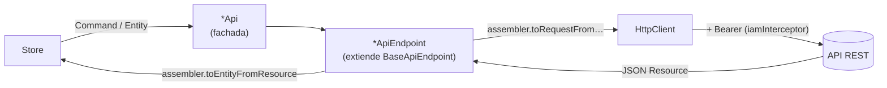

# Arquitectura del frontend

Angular 22 con componentes standalone y signals. Código en [`frontend/src/app`](../../frontend/src/app).

## 1. Módulos por feature

Cada carpeta de primer nivel replica un bounded context del backend:

| Carpeta | Feature | Capas presentes |
|---|---|---|
| `iam/` | [iam](../features/iam/README.md) | domain · application · infrastructure · presentation |
| `groups/` | [groups](../features/groups/README.md) | domain · application · infrastructure · presentation |
| `invitations/` | [invitations](../features/invitations/README.md) | domain · application · infrastructure (sin presentation: la UI está en groups) |
| `tasks/` | [tasks](../features/tasks/README.md) | domain · application · infrastructure · presentation |
| `requests/` | [requests](../features/requests/README.md) | domain · application · infrastructure · presentation |
| `ai/` | [ai](../features/ai/README.md) | domain · application · infrastructure · presentation (solo un componente) |
| `tour/` | [tour](../features/tour/README.md) | domain · presentation |
| `shared/` | Transversal | Clases base, layout, toasts, home y 404 |

Raíz: `app.ts` (renderiza `<app-layout/>`), `app.routes.ts` (rutas de primer nivel) y `app.config.ts` (providers globales).

## 2. Capas dentro de una feature

```text
tasks/
├── domain/model/            entidades y comandos (clases TS con getters/setters), tipos y constantes
├── infrastructure/          acceso HTTP
│   ├── tasks.response.ts        tipos del JSON (Resource, Request, Response)
│   ├── tasks.assembler.ts       Resource ↔ entidad, Command → Request
│   ├── tasks.api-endpoint.ts    URLs y verbos (extiende BaseApiEndpoint)
│   └── tasks.api.ts             fachada inyectable (@Injectable providedIn root)
├── application/
│   └── tasks.store.ts           estado con signals y orquestación de llamadas
└── presentation/
    ├── tasks.routes.ts          rutas hijas (lazy)
    ├── views/                   páginas enrutables
    └── components/              piezas reutilizables
```

| Capa | Depende de | Regla |
|---|---|---|
| `presentation` | `application` (stores), `domain` | Los componentes **no llaman a la API**: inyectan stores, leen sus signals y llaman a sus métodos. |
| `application` | `infrastructure` (`*Api`), `domain` | El store es la única capa que se suscribe a observables HTTP y escribe signals. |
| `infrastructure` | `domain`, `shared/infrastructure`, `environment` | Traduce entre JSON y entidades del dominio y entre códigos HTTP y mensajes de error. |
| `domain` | `shared/domain` | TypeScript puro, sin Angular ni HTTP. |

## 3. Comunicación con el backend: endpoint + assembler



| Pieza (`shared/infrastructure`) | Rol |
|---|---|
| `BaseApiEndpoint<TEntity, TResource, TResponse, TAssembler>` | CRUD genérico (`getAll`, `getById`, `create`, `update`, `delete`) sobre `endpointUrl`, con `handleError`. Las features lo extienden con métodos específicos. |
| `BaseAssembler` | Contrato `toEntityFromResource`, `toResourceFromEntity` y `toEntitiesFromResponse`. |
| `BaseResource` / `BaseResponse` | Tipos base del JSON. Varios métodos aceptan tanto un arreglo como un objeto envoltorio (`TResponse \| TResource[]`). |
| `ErrorHandlingEnabledBaseType` | `handleError` para endpoints que no son CRUD (sign-in, sign-up). |
| `BaseApi` | Clase base vacía para las fachadas `*Api`. |

**URLs**: se construyen desde `src/environments/environment*.ts` con `platformProviderApiBaseUrl` más el path de cada recurso (`platformProviderTasksEndpointPath`, etc.).

| Entorno | `platformProviderApiBaseUrl` |
|---|---|
| Desarrollo (`environment.development.ts`) | `http://localhost:8080/api/v1` |
| Producción (`environment.ts`) | `/api/v1` (mismo origen detrás de nginx o CloudFront) |

**Errores**: los endpoints con reglas de negocio (invitations, requests) traducen 403, 404 y 409 a mensajes en español según la operación. Los demás usan `handleError`. Los stores muestran el mensaje con `ToastStore`, que lo convierte en un texto amigable.

## 4. Estado: stores con signals

- Un store por feature (`IamStore`, `GroupsStore`, `TasksStore`, `InvitationsStore`, `RequestsStore`, `AiStore`) más `ToastStore` en shared, todos `@Injectable({ providedIn: 'root' })`.
- **Patrón**: signals privados y escribibles (`tasksSignal`) expuestos como `asReadonly()` (`tasks`), con estado derivado en `computed` (`filteredTasks`, `groupCount`).
- **Los métodos no devuelven observables**: se suscriben internamente, actualizan los signals y aceptan callbacks `onSuccess` opcionales cuando la vista necesita reaccionar (cerrar un modal, limpiar un input).
- `IamStore` funciona como contexto global de la sesión. Otras features lo inyectan para conocer al usuario actual.
- No se usa NgRx ni ningún otro gestor de estado externo.

## 5. Enrutamiento, sesión y seguridad

| Pieza | Archivo | Función |
|---|---|---|
| Rutas de primer nivel | `app.routes.ts` | `auth`, `home`, `groups`, `tasks`, `validations` y `recorrido`, cargadas de forma diferida con `loadChildren`/`loadComponent`. `''` → `/auth/sign-in`; `**` → `PageNotFound`. |
| Guard | `iam/infrastructure/iam.guard.ts` | `iamGuard` protege todo salvo `auth`. |
| Interceptor | `iam/infrastructure/iam.interceptor.ts` | Agrega `Authorization: Bearer` desde `localStorage.token`, salvo en sign-in y sign-up. |
| Restaurar la sesión | `app.config.ts` → `provideAppInitializer` | `IamStore.restoreSession()` antes del primer render. |
| HTTP | `app.config.ts` | `provideHttpClient(withFetch(), withInterceptors([iamInterceptor]))` |

Los parámetros de contexto viajan en **query params** (`?groupId=`, `?id=&role=`), y el id de recurso en path params (`/tasks/:id`).

## 6. Presentación y estilos

- Componentes standalone con `inject()`, `input()`/`output()` y signals locales.
- **Angular Material** para controles e íconos (`MatIconModule`) y **Tailwind CSS 4** (vía `@tailwindcss/postcss`) para el layout y los colores.
- `shared/presentation`: `Layout` (barra lateral y shell), `ToastContainer`, `BaseForm` (helpers de validación de formularios), `Home` (panel con tablero) y `PageNotFound`.
- La salida de la IA se renderiza **sin `innerHTML`** (`parseReport`).

## 7. Pruebas

- Vitest mediante el builder `@angular/build:unit-test` (`npx ng test --watch=false`).
- Las pruebas son `*.spec.ts` junto al archivo que prueban. Ver la sección "Pruebas" de cada feature.

## 8. Desviaciones conocidas

| Desviación | Detalle |
|---|---|
| `invitations` sin capa `presentation` | Su UI vive en `groups/presentation`. |
| `profiles` sin recurso propio en el backend | `ProfilesApiEndpoint` lee `/users`; `Profile.userId` siempre queda `undefined`. |
| Código comentado en espera del backend | `searchByCode` (el backend **ya lo expone**) e `inviteUserToGroup` (el backend no lo soporta). |
| `IamStore.loadUsers()` incompleto | Solo activa un flag. |
| `BaseApiEndpoint.getAll` deja un `console.log` | — |
| `AiApi` no usa `BaseApiEndpoint` ni assembler | Es intencional: las respuestas se mapean 1 a 1. |

## 9. Cómo agregar una feature

1. Crear `src/app/<feature>/{domain/model,infrastructure,application,presentation}`.
2. En `domain/model`: la entidad (implementa `BaseEntity`) y los comandos.
3. En `infrastructure`: `<feature>.response.ts`, `<feature>.assembler.ts`, `<feature>.api-endpoint.ts` (extiende `BaseApiEndpoint`, con la URL desde `environment`) y `<feature>.api.ts`. Agregar el path del recurso a los dos archivos de `environment`.
4. En `application`: `<feature>.store.ts` con signals de solo lectura y métodos que se suscriben.
5. En `presentation`: `<feature>.routes.ts`, vistas y componentes. Registrar la ruta en `app.routes.ts` con `canActivate: [iamGuard]` y agregar el enlace en `Layout`.
6. Documentar en `docs/features/<feature>/` (README, backend y frontend).
