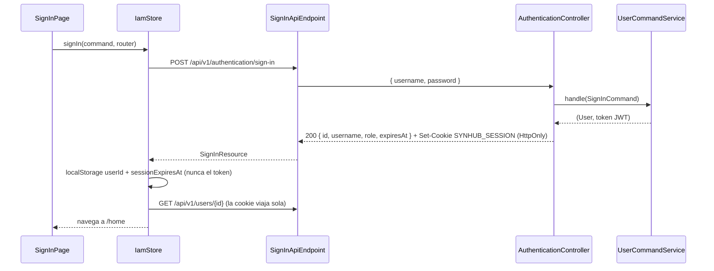

# IAM: identidad y acceso

Registro de cuentas, inicio de sesión con JWT, consulta de usuarios y roles de cuenta. Es la base de las demás features: todas identifican al usuario actual a partir del token que emite IAM.

| | |
|---|---|
| **Recursos REST** | `/api/v1/authentication`, `/api/v1/users`, `/api/v1/roles` |
| **Bounded context (backend)** | [`iam`](../../../backend/src/main/java/com/hub/synhub_backend/iam) |
| **Módulo (frontend)** | [`src/app/iam`](../../../frontend/src/app/iam) |
| **Rutas de la web** | `/auth/sign-in`, `/auth/sign-up` |
| **Documentación** | [Backend](backend/README.md) · [Frontend](frontend/README.md) |

## Qué resuelve

- **Registro** (`sign-up`): crea un `User` con contraseña hasheada (BCrypt) y uno o más roles de cuenta.
- **Inicio de sesión** (`sign-in`): valida credenciales y abre una sesión de 1 día: el JWT viaja en la cookie `HttpOnly` `SYNHUB_SESSION` (HUM-04). `sign-out` la borra.
- **Sesión en la web**: el JWT viaja en una cookie `HttpOnly` de 1 día que el JavaScript no puede leer (decisión HUM-04). Un interceptor envía las peticiones con credenciales y cierra la sesión ante un 401; un guard protege las rutas privadas.
- **Consulta de usuarios**: `/users/me`, `/users/{id}` y `/users/username?username=`; otras features las usan para resolver perfiles.

## Comunicación frontend ↔ backend

| Acción en la web | Frontend | Petición | Backend |
|---|---|---|---|
| Iniciar sesión | `SignInPage` → `IamStore.signIn` | `POST /authentication/sign-in` | `AuthenticationController.signIn` → `UserCommandService.handle(SignInCommand)` |
| Cargar el perfil tras el login | `IamStore.signIn` → `IamApi.getProfileByUserId` | `GET /users/{id}` | `UsersController.getUserById` |
| Registrarse (y entrar) | `SignUpPage` → `IamStore.signUp` → `IamStore.signIn` | `POST /authentication/sign-up`, luego `POST /authentication/sign-in` | `AuthenticationController.signUp` → `UserCommandService.handle(SignUpCommand)` |
| Restaurar la sesión al recargar | `provideAppInitializer` → `IamStore.restoreSession` | `GET /users/me` y luego `GET /users/{id}` | `UsersController.me` / `getUserById` |
| Invitar por nombre de usuario (feature [invitations](../invitations/README.md)) | `InvitationsStore.inviteByUsername` → `IamApi.getProfileByUsername` | `GET /users/username?username=` | `UsersController.getUserByUsername` |

## Propiedad compartida

- **`User` es referenciado por otros contextos**: `GroupProfile.user` e `Invitation.user` (groups) apuntan directamente a la entidad JPA de IAM. El dueño del agregado sigue siendo IAM.
- **Usuario actual en los controladores**: todos los controladores (groups, tasks, requests, ai) resuelven el usuario autenticado con `UserQueryService` + `GetUserByUsernameQuery`. Es una dependencia directa hacia IAM, no mediante la ACL.
- **Frontend**: `InvitationsStore` usa `IamApi` (de IAM) para buscar usuarios por nombre; `GroupsStore`, `TasksStore` y `RequestsStore` inyectan `IamStore` para conocer al usuario actual.

Más detalle en [Propiedad entre features](../../architecture/cross-feature-ownership.md).
