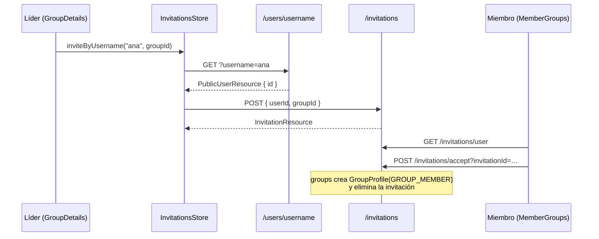

# Invitations: invitaciones a grupos

El líder de un grupo invita a un usuario por su nombre de usuario; el invitado acepta (y pasa a ser miembro) o rechaza. El líder también puede cancelar una invitación enviada.

| | |
|---|---|
| **Recurso REST** | `/api/v1/invitations` |
| **Bounded context (backend)** | **[`groups`](../../../backend/src/main/java/com/hub/synhub_backend/groups)**: no hay un paquete `invitations` |
| **Módulo (frontend)** | [`src/app/invitations`](../../../frontend/src/app/invitations): sin vistas propias |
| **Dónde aparece en la web** | `/groups/member` (invitaciones recibidas) y `/groups?id=…` (invitar y ver las enviadas) |
| **Documentación** | [Backend](backend/README.md) · [Frontend](frontend/README.md) |

## A quién le pertenece

Es una feature con **dueño dividido** y conviene tenerlo claro antes de tocarla:

| Capa | Dueño real | Motivo |
|---|---|---|
| Recurso REST | invitations | Tiene su propia URL raíz, `/api/v1/invitations`. |
| Dominio y persistencia (backend) | **groups** | `Invitation` es un agregado del paquete `groups`, `Group.invitations` lo contiene con `cascade = ALL` y aceptar crea un `GroupProfile` (membresía). Es una regla de groups. |
| Estado y API (frontend) | invitations | `InvitationsStore`, `InvitationsApi` y el modelo `Invitation` viven en `src/app/invitations`. |
| Vistas (frontend) | **groups** | No hay vistas en `invitations/presentation`: la UI está en `MemberGroups` y `GroupDetails`. |

Si se cambia una regla de invitación (quién puede invitar, duplicados, aceptación), el cambio va en el paquete `groups` del backend.

## Comunicación frontend ↔ backend

| Acción en la web | Frontend | Petición | Backend |
|---|---|---|---|
| Invitar por nombre de usuario (líder) | `GroupDetails` → `InvitationsStore.inviteByUsername` | 1) `GET /users/username?username=` (IAM) 2) `POST /invitations { userId, groupId }` | `UsersController.getUserByUsername`, luego `InvitationController.createInvitation` → `CreateInvitationCommand` |
| Ver invitaciones enviadas del grupo | `GroupDetails` → `loadGroupInvitations` | `GET /invitations/group?groupId=` | `getInvitationsByGroup` → `GetInvitationsByGroupIdQuery` |
| Ver mis invitaciones | `MemberGroups` → `loadInvitations` | `GET /invitations/user` | `getUserInvitations` → `GetInvitationsByUserIdQuery` |
| Aceptar | `MemberGroups` → `acceptInvitation` | `POST /invitations/accept?invitationId=` | `acceptInvitation` → `AcceptInvitationCommand`: crea la membresía `GROUP_MEMBER` y borra la invitación |
| Rechazar (invitado) / cancelar (líder) | `MemberGroups` / `GroupDetails` → `declineInvitation` | `DELETE /invitations/{id}` | `cancelInvitation` → `CancelInvitationCommand` |

## Dependencias

- **Backend**: depende de IAM (`IamContextFacade`, para cargar al invitado) y de las membresías de groups (`GroupProfileRepository`).
- **Frontend**: `InvitationsStore` depende de `IamApi` (buscar el usuario) y de `IamStore`; `InvitationsAssembler` reutiliza `GroupsAssembler` y `ProfilesAssembler`.
