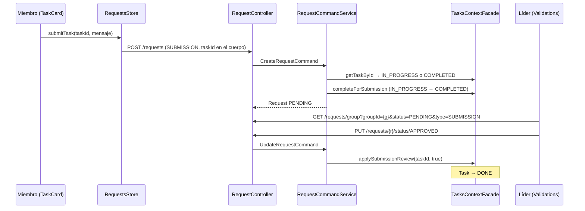

# Requests: entregas, solicitudes y validaciones

Una **request** es una solicitud ligada a una tarea que el líder del grupo revisa. Hay tres tipos:

| Tipo | Quién la crea | Efecto al revisarla |
|---|---|---|
| `SUBMISSION` | El integrante asignado, al marcar completada su tarea (la "entrega"): la tarea pasa a `COMPLETED` y queda pendiente de validación | Aprobar → la tarea pasa a `DONE`. Rechazar → vuelve a `IN_PROGRESS`. |
| `MODIFICATION` | El integrante asignado, sobre una tarea `IN_PROGRESS`, con un comentario obligatorio. La tarea pasa a `ON_HOLD` y **su reloj se detiene** | El líder la **aprueba editando la tarea** (cualquier cambio de título, descripción, fecha o clasificación): la request queda `APPROVED` y la tarea vuelve a `IN_PROGRESS`. O la **deniega** (`REJECTED`): la tarea vuelve a `IN_PROGRESS` tal como estaba y su reloj se reanuda. No se aprueba ni se borra directamente (409) y, mientras está pendiente, la tarea tampoco se reanuda a mano (409). |
| `EXPIRED` | El sistema (`TaskStatusScheduler` de tasks) cuando una tarea vence | **No se puede rechazar** (409): solo se reanuda la tarea, y **reanudarla por cualquier vía** (Validaciones o el tablero) cierra el aviso (`APPROVED`). En la web: "Reanudar tarea" (nueva fecha futura → `IN_PROGRESS`). |

Estados: `PENDING` → `APPROVED` \| `REJECTED` (una sola revisión).

| | |
|---|---|
| **Recursos REST** | `/api/v1/requests` (recurso raíz: `/requests`, `/requests/task?taskId=`, `/requests/group?groupId=`, `/requests/{id}/status/{status}`) |
| **Bounded context (backend)** | [`requests`](../../../backend/src/main/java/com/hub/synhub_backend/requests) |
| **Módulo (frontend)** | [`src/app/requests`](../../../frontend/src/app/requests) |
| **Rutas de la web** | `/validations?groupId=` (bandeja del líder, con filtro por tipo) y, en `TaskCard`, "marcar completada y enviar a validación" y "solicitar modificación" |
| **Documentación** | [Backend](backend/README.md) · [Frontend](frontend/README.md) |

## Comunicación frontend ↔ backend

| Acción en la web | Frontend | Petición | Backend |
|---|---|---|---|
| Marcar completada y enviar a validación (miembro, solo tareas `IN_PROGRESS`, sin comentario) | `TaskCard` → `RequestsStore.submitTask` | `POST /requests { taskId, description: "Tarea completada.", requestType: "SUBMISSION" }` (la tarea pasa a `COMPLETED`) | `RequestController.createRequest` → `CreateRequestCommand` |
| Saber si la tarea está "en revisión" | `TaskCard` → `loadTaskRequests` / `isUnderReview` | `GET /requests/task?taskId=` | `getRequestsByTaskId` |
| Pedir una modificación (miembro, tarea `IN_PROGRESS`, con comentario) | `TaskCard` → `RequestsStore.createModification` | `POST /requests { taskId, description, requestType: "MODIFICATION" }` (la tarea pasa a `ON_HOLD`) | `RequestController.createRequest` → `TasksContextFacade.putOnHoldForModification` |
| Bandeja de validaciones (líder) | `Validations` → `loadGroupRequests(groupId, status, type)` | `GET /requests/group?groupId=&status=PENDING&type=SUBMISSION\|MODIFICATION\|EXPIRED` | `RequestController.getRequestsByGroupId` → `GetRequestsByGroupIdQuery` |
| Aprobar / rechazar | `Validations` → `approveRequest` / `rejectRequest` | `PUT /requests/{id}/status/APPROVED\|REJECTED` | `updateRequestStatus` → `UpdateRequestCommand` → `TasksContextFacade.applySubmissionReview` |

## Propiedad compartida

- **`GET /requests/group?groupId=`** recibe un grupo, pero **le pertenece a requests**: lo implementa `RequestController` y solo consulta `RequestRepository`. Del lado de groups solo usa `GroupsContextFacade.fetchLeaderIdByGroupId`, para validar al líder.
- **`Request.task`** es un `@ManyToOne` hacia el agregado `Task` de tasks. `RequestRepository.findByTask_Profile_Group_Id` navega request → task → membresía (groups) → grupo, así que la consulta cruza tres contextos.
- **Requests modifica tareas** solo mediante la ACL `TasksContextFacade` (`getTaskById`, `completeForSubmission`, `applySubmissionReview`). Es el ejemplo de integración más limpio del backend.
- **Requests `EXPIRED`**: la request es de requests, pero la crea `TaskStatusScheduler` (tasks).
- **Frontend**: `RequestsApiEndpoint` llama al recurso `/requests`; `RequestsAssembler` reutiliza `TasksAssembler`; `TaskCard` (tasks) inyecta `RequestsStore`, y `Validations` usa `GroupsStore` para elegir el grupo.

Más detalle en [Propiedad entre features](../../architecture/cross-feature-ownership.md).

## Grupos bloqueados

Crear (`POST /requests`), revisar y borrar solicitudes responden 409 (`GroupLockedException`) si el grupo de la tarea está bloqueado por el plan de su líder (después de los permisos). La solicitud `EXPIRED` que crea el sistema sigue registrándose. En la web, `Validations` muestra "Grupo bloqueado: solo lectura" en lugar de las acciones. Ver [subscriptions](../subscriptions/README.md).
