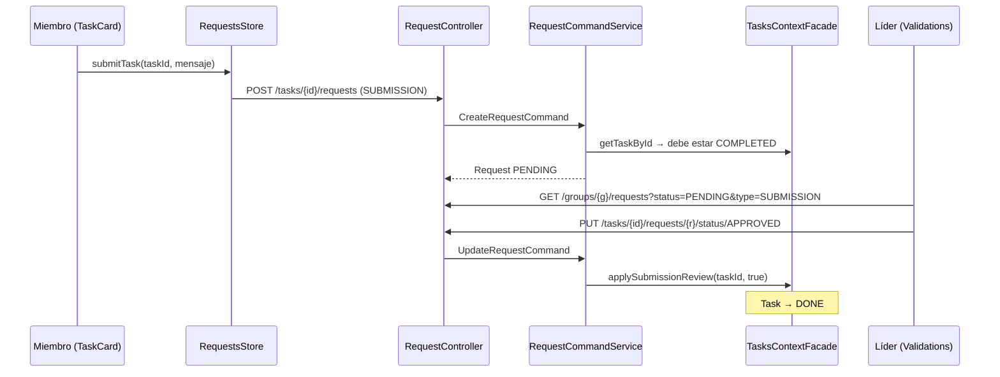

# Requests: entregas, solicitudes y validaciones

Una **request** es una solicitud ligada a una tarea que el líder del grupo revisa. Hay tres tipos:

| Tipo | Quién la crea | Efecto al revisarla |
|---|---|---|
| `SUBMISSION` | El integrante asignado, cuando su tarea está `COMPLETED` (la "entrega") | Aprobar → la tarea pasa a `DONE`. Rechazar → vuelve a `IN_PROGRESS`. |
| `MODIFICATION` | El integrante asignado | Solo cambia el estado de la request; la tarea no se modifica. |
| `EXPIRED` | El sistema (`TaskStatusScheduler` de tasks) cuando una tarea vence | Solo cambia el estado de la request. |

Estados: `PENDING` → `APPROVED` \| `REJECTED` (una sola revisión).

| | |
|---|---|
| **Recursos REST** | `/api/v1/tasks/{taskId}/requests` (sub-recurso de tareas) y `/api/v1/groups/{groupId}/requests` (vista por grupo) |
| **Bounded context (backend)** | [`requests`](../../../backend/src/main/java/com/hub/synhub_backend/requests) |
| **Módulo (frontend)** | [`src/app/requests`](../../../frontend/src/app/requests) |
| **Rutas de la web** | `/validations?groupId=` (bandeja del líder) y el botón "enviar entrega" de `TaskCard` |
| **Documentación** | [Backend](backend/README.md) · [Frontend](frontend/README.md) |

## Comunicación frontend ↔ backend

| Acción en la web | Frontend | Petición | Backend |
|---|---|---|---|
| Enviar entrega (miembro) | `TaskCard` → `RequestsStore.submitTask` | `POST /tasks/{taskId}/requests { description, requestType: "SUBMISSION" }` | `RequestController.createRequest` → `CreateRequestCommand` |
| Saber si la tarea está "en revisión" | `TaskCard` → `loadTaskRequests` / `isUnderReview` | `GET /tasks/{taskId}/requests` | `getRequestsByTaskId` |
| Bandeja de validaciones (líder) | `Validations` → `loadGroupSubmissions(groupId, status)` | `GET /groups/{groupId}/requests?status=PENDING&type=SUBMISSION` | `GroupRequestController.getRequestsByGroup` → `GetRequestsByGroupIdQuery` |
| Aprobar / rechazar | `Validations` → `approveSubmission` / `rejectSubmission` | `PUT /tasks/{taskId}/requests/{id}/status/APPROVED\|REJECTED` | `updateRequestStatus` → `UpdateRequestCommand` → `TasksContextFacade.applySubmissionReview` |

## Propiedad compartida

- **`GET /groups/{groupId}/requests`** usa la URL de groups, pero **le pertenece a requests**: lo implementa `GroupRequestController` en el paquete `requests` y solo consulta `RequestRepository`. Del lado de groups solo usa `GroupsContextFacade.fetchLeaderIdByGroupId`, para validar al líder.
- **`Request.task`** es un `@ManyToOne` hacia el agregado `Task` de tasks. `RequestRepository.findByTask_Profile_Group_Id` navega request → task → membresía (groups) → grupo, así que la consulta cruza tres contextos.
- **Requests modifica tareas** solo mediante la ACL `TasksContextFacade` (`getTaskById`, `applySubmissionReview`). Es el ejemplo de integración más limpio del backend.
- **Requests `EXPIRED`**: la request es de requests, pero la crea `TaskStatusScheduler` (tasks).
- **Frontend**: `RequestsApiEndpoint` llama a URLs bajo `/tasks` y `/groups`; `RequestsAssembler` reutiliza `TasksAssembler`; `TaskCard` (tasks) inyecta `RequestsStore`, y `Validations` usa `GroupsStore` para elegir el grupo.

Más detalle en [Propiedad entre features](../../architecture/cross-feature-ownership.md).
