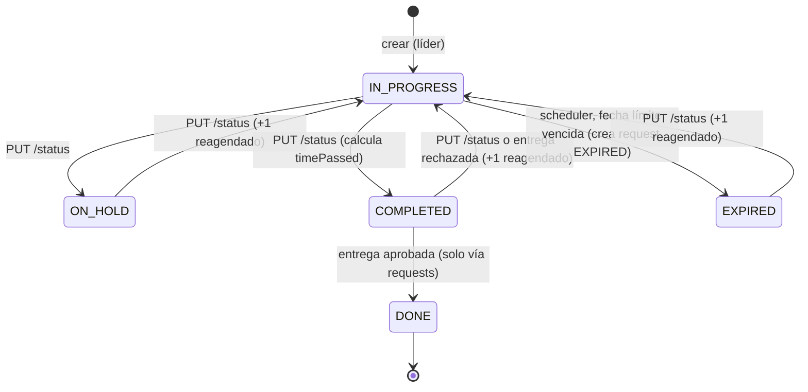

# Tasks: tareas de un grupo

El líder crea tareas dentro de su grupo y se las asigna a un integrante. El integrante avanza la tarea por un tablero Kanban; al completarla envía una **entrega**, que el líder revisa (feature [requests](../requests/README.md)). Una tarea solo pasa a `DONE` cuando el líder aprueba esa entrega.

| | |
|---|---|
| **Recurso REST** | `/api/v1/tasks` |
| **Bounded context (backend)** | [`tasks`](../../../backend/src/main/java/com/hub/synhub_backend/tasks) (el subpaquete se llama `aplication`, sic) |
| **Módulo (frontend)** | [`src/app/tasks`](../../../frontend/src/app/tasks) |
| **Rutas de la web** | `/tasks/leader`, `/tasks/member`, `/tasks/create`, `/tasks/:id`, `/tasks/:id/edit`, además del tablero en `/home` y `/groups?id=…` |
| **Documentación** | [Backend](backend/README.md) · [Frontend](frontend/README.md) |

## Ciclo de vida de una tarea

- `PUT /tasks/{id}/status` acepta cualquier estado **excepto `DONE`** (responde 409 `TaskStatusTransitionNotAllowedException`). Pueden hacerlo el líder o el integrante asignado.
- `PUT /tasks/{id}` con una `dueDate` pasada mueve la tarea a `EXPIRED`; con una fecha futura la vuelve a `IN_PROGRESS`, salvo que ya esté `EXPIRED`.
- `TaskStatusScheduler` revisa cada 60 s las tareas `IN_PROGRESS` vencidas: las marca `EXPIRED` y crea una solicitud `EXPIRED` en requests.
- En la web, una tarea `DONE` no se puede editar ni eliminar (`TasksStore` lo bloquea).

## Comunicación frontend ↔ backend

| Acción en la web | Frontend | Petición | Backend |
|---|---|---|---|
| Crear tarea (líder) | `TaskForm` → `TasksStore.addTask` | `POST /tasks` | `TaskController.createTask` → `CreateTaskCommand` |
| Sugerir clasificación con IA | `TaskForm` → `AiStore.classifyTask` | `POST /ai/classify` | [ai](../ai/README.md) |
| Editar tarea (líder) | `TaskForm` → `TasksStore.updateTask` | `PUT /tasks/{id}` | `updateTaskDetails` → `UpdateTaskCommand` |
| Ver detalle | `TaskDetails`, `TaskForm` (edición) → `loadTaskById` | `GET /tasks/{id}` | `getTaskById` |
| Tablero del grupo | `Home`, `GroupDetails`, `LeaderTasks` → `loadTasksByGroup` | `GET /tasks/group/{groupId}[?status=]` | `getByGroup` → `GetTasksByGroupIdAndStatus` |
| Mis tareas | `MemberTasks` → `loadMyTasks` | `GET /tasks/user` (una sola petición) | `getMyTasks` → `GetAllTasksByUserId` |
| Mover de columna | `TaskBoard` (`statusChange`) → `updateTaskStatus` | `PUT /tasks/{id}/status?status=` | `updateTaskStatus` → `UpdateTaskStatusCommand` |
| Eliminar (líder) | `GroupDetails`, `LeaderTasks` → `deleteTask` | `DELETE /tasks/{id}` | `deleteTaskById` → `DeleteTaskCommand` |
| Enviar entrega (miembro) | `TaskCard` → `RequestsStore.submitTask` | `POST /tasks/{id}/requests` | [requests](../requests/README.md) |

## Propiedad compartida

- **Asignación mediante groups**: `Task.profile` apunta a `GroupProfile` (la membresía de groups) y `GroupProfile.tasks` es la colección inversa. Una tarea no tiene `userId` ni `groupId` propios: ambos se derivan de la membresía. `TaskResource` expone `group` y `assignedTo` armados con assemblers de groups e IAM.
- **`TaskCommandServiceImpl` usa repositorios de otros contextos** (`GroupRepository`, `GroupProfileRepository` de groups y `UserRepository` de IAM) en lugar de sus ACL.
- **Scheduler de vencimiento**: `TaskStatusScheduler` está en `tasks/aplication/internal/schedulers`, pero escribe en **requests** (`RequestCommandService`, solicitud `EXPIRED`). El proceso es de tasks y el dato resultante es de requests.
- **`DONE` lo decide requests**: requests llama a `TasksContextFacade.applySubmissionReview` al revisar una entrega. Es la única vía hacia `DONE`.
- **Campos de IA en `Task`** (`difficulty`, `context`, `urgency`, `labels`, `aiAccepted`): se persisten en tasks, pero los produce [ai](../ai/README.md) y los consume su informe de grupo.
- **Métricas**: `TaskMetricsQueryServiceImpl` ([metrics](../metrics/README.md)) lee `TaskRepository` directamente.
- **Frontend**: `TaskCard` (tasks) usa `RequestsStore`; `TaskForm` usa `AiStore` y `GroupsStore`; `LeaderTasks` incrusta `AiReportCard` (ai); `Home` (shared) y `GroupDetails` (groups) usan `TasksStore`.

Más detalle en [Propiedad entre features](../../architecture/cross-feature-ownership.md).
